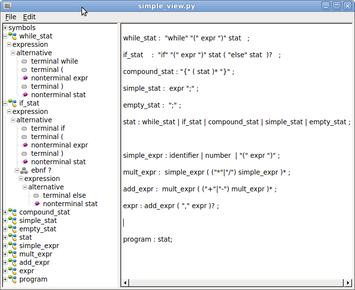

# C1 — tutorial/cecko.g

A simple grammar for expressions and statements, used in the chapter
"Machine-Generated Syntactic Analyzers".

[cecko.g](http://gitlab.fjfi.cvut.cz/culikzde/simple-view/-/blob/master/tutorial/cecko.g)

```
while_stat :  "while" "(" expr ")" stat   ;

if_stat    :  "if" "(" expr ")" stat ( "else" stat  )?   ;

compound_stat : "{" ( stat )* "}" ;

simple_stat :  expr ";" ;

empty_stat :  ";" ;

stat : while_stat | if_stat | compound_stat | simple_stat | empty_stat ;


simple_expr : identifier | number  | "(" expr ")" ;

mult_expr :  simple_expr ( ("*"|"/") simple_expr )* ;

add_expr :  mult_expr ( ("+"|"-") mult_expr )* ;

expr : add_expr ( "=" expr )? ;


program : stat;
```

The input file with one statement
[c1.cc](http://gitlab.fjfi.cvut.cz/culikzde/simple-view/-/blob/master/tutorial/c1.cc)

```
{
   while ( n )
      if ( n )
         n = n + 2;
      else
         n = n * 2;
}
```

The picture used in the chapter [Parser](parser.md):


