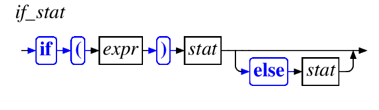

# Displaying the Grammar Using the LOUT Program

**The Lout program**

http://jeffreykingston.id.au/lout/
Manual, chapter 9.8. Syntax diagrams

Consider the grammar rule on the input:

```
   if_stat  :  "if" "(" expr ")" stat ( "else" stat  )? ;
```

The program *plain_tolout.py*
http://gitlab.fjfi.cvut.cz/culikzde/simple-view/-/blob/master/tutorial/plain-grammar/plain_tolout.py
walks through the grammar stored in the tree and
produces the following textual output:

```
@SyntaxDiag
title {if_stat}
{
   @StartRight
   @Sequence
   A {blue @Color @BCell "if"}
   B {blue @Color @BCell "("}
   C {@ACell "expr"}
   D {blue @Color @BCell ")"}
   E {@ACell "stat"}
   F {@Optional
         @Sequence
         A {blue @Color @BCell "else"}
         B {@ACell "stat"}
   }
}
```

This text is the input for the Lout program.
Lout produces the output in PostScript: [gram.ps](pictures/gram.ps)



The legendary grammar of the Pascal programming language http://www.cs.utexas.edu/users/novak/grammar.html
