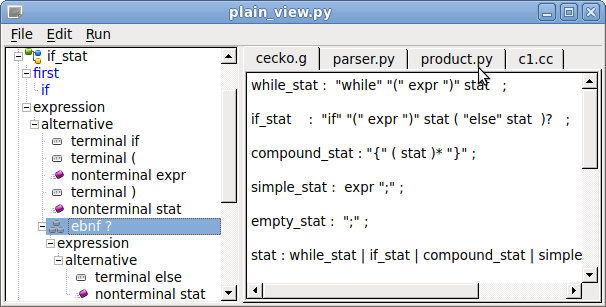
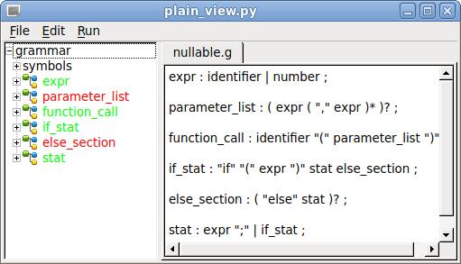

# Nullable Rules

First we find the *nullable rules*, that is, rules that can be rewritten
to an empty sequence.

Here is a link to the program that searches for the nullable rules (and
which we describe here):
https://gitlab.fjfi.cvut.cz/culikzde/simple-view

As a reminder, [reading the grammar description and storing it in a tree
structure](gram_parser.md),
a picture of one rule stored in a tree:



For the individual terminals, nonterminals, expressions in parentheses,
alternatives and whole expressions we gradually set the boolean variable
**nullable**.

First we mark all rules as *non-nullable*:

```python
    for rule in grammar.rules :
        rule.nullable = False
```

## Terminal Symbols

Terminal symbols are never nullable,
*because we cannot rewrite them into anything other than the same
terminal symbol, and that is a one-element sequence of symbols.*

```python
def nullableTerminal (grammar, item) :
    item.nullable = False
```

## Nonterminal Symbols

Nonterminal symbols get their value based on the rule that the
nonterminal represents.

```python
def nullableNonterminal (grammar, item) :
    rule = item.rule_ref
    item.nullable = rule.nullable
```

## Expressions in Parentheses

An expression in parentheses is first assigned the same value as the
inner expression; that value will be determined by the
**nullableExpression** function.
If a question mark or an asterisk follows the parentheses, then
**( )?** as well as **( )*** are nullable.

```python
def nullableEbnf (grammar, ebnf) :
    nullableExpression (grammar, ebnf.expr)

    expr = ebnf.expr
    # set ebnf according to expression
    ebnf.nullable = expr.nullable
    # ( )? or ( )* => ebnf is nullable
    if ebnf.mark == '?' or ebnf.mark == '*' :
       ebnf.nullable = True
```

## Alternatives

Alternatives are sequences of terminals, nonterminals and expressions in
parentheses.
We first mark the alternative as nullable; *if the alternative is empty,
it will be nullable.*
Then we walk through the individual grammar items and if we find a
non-nullable one,
we stop and the alternative will be non-nullable.
*That is, one non-nullable item is enough and the alternative is
non-nullable.*

```python
def nullableAlternative (grammar, alt) :
    # init
    alt.nullable = True

    for item in alt.items :
        if isinstance (item, Terminal) :
           nullableTerminal (grammar, item)
        elif isinstance (item, Nonterminal) :
           nullableNonterminal (grammar, item)
        elif isinstance (item, Ebnf) :
           nullableEbnf (grammar, item)
        else :
           grammar.error ("Unknown alternative item: " + item.__class__.__name__)

        # one item is not nullable => alternative is also not nullable
        if not item.nullable :
           alt.nullable = False
           break
```

## Expressions

We use expressions for the description of whole rules or as the insides
of expressions in parentheses.
Expressions are sequences of alternatives separated by **|**.
An expression contains at least one alternative, but that alternative
may be empty.

If we find at least one *nullable* alternative, the whole expression is
*nullable*.

```python
def nullableExpression (grammar, expr) :
    expr.nullable = False

    for alt in expr.alternatives :
       nullableAlternative (grammar, alt)

       # one alternative is nullable => expression is nullable
       if alt.nullable :
          expr.nullable = True
          break
```

## Rules

First we marked all rules as *non-nullable*.

Then we run the computation for all the expressions that form the
descriptions of the individual rules.
We watch whether some rule became *nullable*.
If so, we repeat the computation again for all the rules.

If the set of *nullable* rules did not change, we are done.

```python
def nullableRules (grammar) :
    for rule in grammar.rules :
        rule.nullable = False

    grammar.nullableChanged = True
    while grammar.nullableChanged :
       grammar.nullableChanged = False
       for rule in grammar.rules :
           nullableRule (grammar, rule)
```

```python
def nullableRule (grammar, rule) :
    expr = rule.expr
    nullableExpression (grammar, expr)
    if rule.nullable != expr.nullable :
       rule.nullable = expr.nullable
       grammar.nullableChanged = True
```

# Example

```
expr : identifier | number ;

parameter_list : ( expr ( "," expr )* )? ;

function_call : identifier "(" parameter_list ")" ;

if_stat : "if" "(" expr ")" stat else_section ;

else_section : ( "else" stat )? ;

stat : expr ";" | if_stat ;
```

The nullable rules are marked in red:



# Useful Links

http://fileadmin.cs.lth.se/cs/Education/EDAN65/2017/lectures/L05A.pdf
https://mkaul.wordpress.com/2009/12/11/computing-nullable-first-and-follow-sets/
http://stackoverflow.com/questions/29197332/how-to-find-first-and-follow-sets-of-a-recursive-grammar
http://www.youtube.com/watch?v=8nBoVjEOCMI
