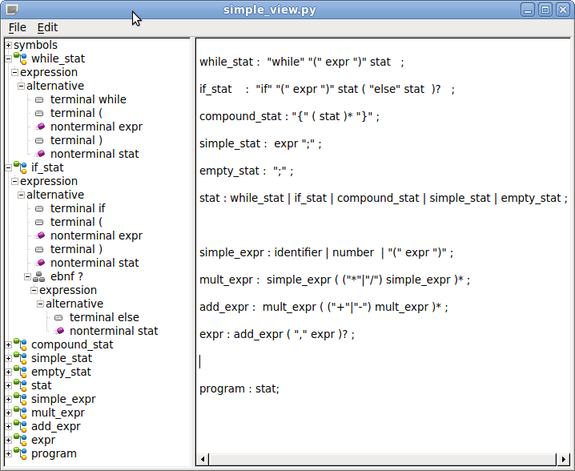

# Parser for the Grammar Description and Storing the Grammar in a Tree

http://github.com/zdenekzc/plain-grammar/blob/main/plain_grammar.py

The input will be some grammar, for example:

```
while_stat :  "while" "(" expr ")" stat   ;

if_stat    :  "if" "(" expr ")" stat ( "else" stat  )?   ;

compound_stat : "{" ( stat )* "}" ;

simple_stat :  expr ";" ;

empty_stat :  ";" ;

stat : while_stat | if_stat | compound_stat | simple_stat | empty_stat ;
```

(This input, consisting of several grammar rules, should satisfy the
[grammar describing the grammar](gram.md) described earlier.)

We want to read the individual rules and store them in the computer's
memory.

## Classes for Storing the Grammar

Several classes for storing information:

```python
class Rule (object) :
   def __init__ (self) :
       self.name = ""
       self.expr = None

class Expression (object) :
   def __init__ (self) :
       self.alternatives = [ ]

class Alternative (object) :
   def __init__ (self) :
       self.items = [ ]

class Ebnf (object) :
   def __init__ (self) :
       self.mark = ""
       self.expr = None

class Nonterminal (object) :
   def __init__ (self) :
       self.rule_name = ""

class Terminal (object) :
   def __init__ (self) :
       self.text = ""
       self.multiterminal_name = ""
```

## Parser for Grammar Descriptions

```python
class Grammar (Lexer) :

   def __init__ (self) :
       super (Grammar, self).__init__ ()
       self.rules = [ ]
       self.multiterminals = [ "identifier",
                               "number",
                               "real_number",
                               "character_literal",
                               "string_literal" ]

   def setPosition (self, item) :
       item.src_line = self.tokenLineNum
       item.src_column = self.tokenColNum
       item.src_pos = self.tokenByteOfs
```

### Rules

Until the end of the source text is reached, we read the individual rules.

```python
   def parseRules (self) :
       while not self.isEndOfSource () :
          self.parseRule ()
```

The information about each rule is stored in an instance of the
**Rule** class.
We read the rule name from the input,
we check the colon,
the description after the colon is read by the **parseExpression**
function,
and we check the semicolon.

```python
   def parseRule (self) :
       rule = Rule ()

       rule.name = self.readIdentifier ("Rule identifier expected")
       self.setPosition (rule)

       self.checkSeparator (':')
       rule.expr = self.parseExpression ()
       self.checkSeparator (';')

       self.rules.append (rule)
```

### Expressions — Rule Descriptions

We store the description of a rule in the **Expression** class.
We read one alternative and insert it into the **expr.alternatives**
list.
If a **|** follows, we read further alternatives and store them in the
list as well.

```python
   def parseExpression (self) :
       expr = Expression ()
       self.setPosition (expr)

       alt = self.parseAlternative ()
       expr.alternatives.append (alt)

       while self.isSeparator ('|') :
          self.nextToken ()

          alt = self.parseAlternative ()
          expr.alternatives.append (alt)

       return expr
```

### Alternatives

We read the individual items until we encounter a vertical bar, a right
parenthesis or a semicolon.

Alternatives are sequences of identifiers (nonterminal symbols),
strings in quotes (terminal symbols)
or expressions in parentheses.

An alternative may also be empty.

The individual items are stored in the **items** list of the
**Alternative** class.

```python
   def parseAlternative (self) :
       alt = Alternative ()
       self.setPosition (alt)

       while not self.isSeparator ('|') and not self.isSeparator (')') and not self.isSeparator (';') :

          if self.token == self.identifier :
             if self.tokenText in self.multiterminals :
                item = self.parseMultiterminal ()
             else :
                item = self.parseNonterminal ()
             alt.items.append (item)

          elif self.token == self.character_literal or self.token == self.string_literal :
             item = self.parseTerminal ()
             alt.items.append (item)

          elif self.isSeparator ('(') :
             ebnf = self.parseEbnf ()
             alt.items.append (ebnf)

          else :
             self.error ("Unknown grammar item")

       return alt
```

### Expressions in Parentheses

We check and skip the left parenthesis.
We read the description inside the parentheses, recursively using the
already mentioned **parseExpression** function.
We check and skip the right parenthesis.

*That is, the same procedure as for arithmetic expressions.*

If a question mark, a plus or an asterisk follows the parentheses, we
read that mark as well.

```python
   def parseEbnf (self) :
       item = Ebnf ()
       self.setPosition (item)

       self.checkSeparator ('(')
       item.expr = self.parseExpression ()
       self.checkSeparator (')')

       if self.isSeparator ('?') or self.isSeparator ('+') or self.isSeparator ('*') :
          item.mark = self.tokenText
          self.nextToken ()

       return item
```

### Terminals and Nonterminals

Nonterminal symbols — the name is stored in the **Nonterminal** class.
Terminal symbols — the text inside the quotes is stored in the
**Terminal** class.

```python
   def parseNonterminal (self) :
       item = Nonterminal ()
       self.setPosition (item)
       item.rule_name = self.tokenText
       self.nextToken ()
       return item

   def parseTerminal (self) :
       item = Terminal ()
       self.setPosition (item)
       item.text = self.tokenText
       self.nextToken ()
       return item
```

### Multiterminals

My nonstandard name for terminal symbols that represent whole groups of
terminal symbols.

They are identifiers, integers and real numbers, and strings in single
and double quotes:

- identifier
- number
- real_number
- character_literal
- string_literal

For example, in the rule

```
    simple_expr : identifier | number  | "(" expr ")" ;
```

- *simple_expr* and *expr* are nonterminal symbols
- "(" and ")" are terminal symbols
- identifier and number are multiterminals (and at the same time also
  terminal symbols)

*Since they are written as identifiers without quotes, they resemble
nonterminals.*

*These grouped terminal symbols are needed so that the sets of terminal
symbols remain finite.*
*(The set of symbols from which the output sequence (output tape) of
lexical analysis is formed.)*
*(And that is at the same time the set of symbols from which the input
sequence (tape) of syntactic analysis is formed.)*

```python
   def parseMultiterminal (self) :
       item = Terminal ()
       self.setPosition (item)
       item.multiterminal_name = self.tokenText
       self.nextToken ()
       return item
```

## Storing the Grammar in Tree Form

https://github.com/zdenekzc/plain-grammar

run `python plain_view.py`

The input grammar is shown in the right part of the window; the tree on
the left displays information about the loaded grammar.


