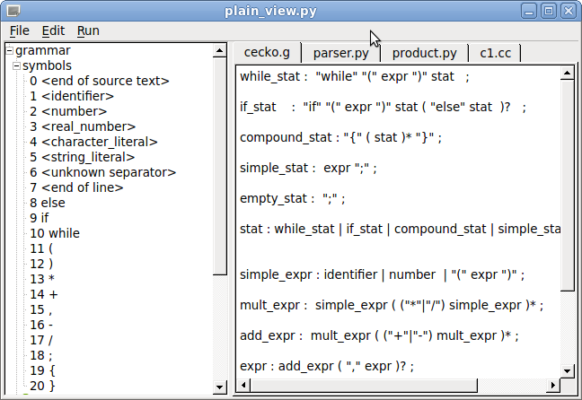
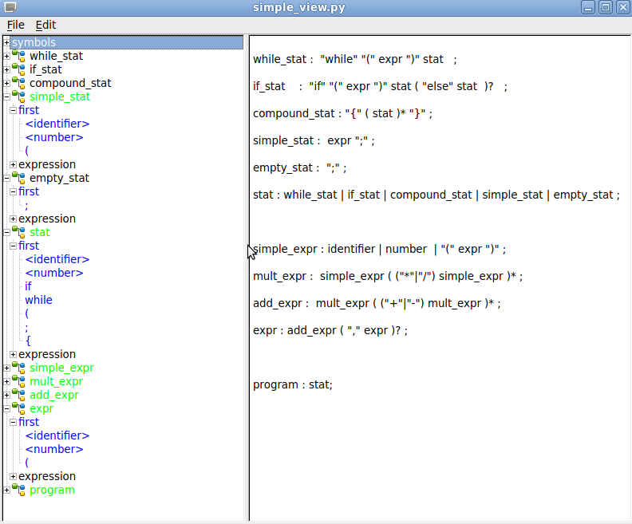

# Sets of Symbols with which the Individual Grammar Rules Begin

Once the nullable rules have been found, we can search for the sets of
terminal symbols with which the individual grammar rules begin.
We use these sets when deciding which alternative the parser should
continue with.

http://gitlab.fjfi.cvut.cz/culikzde/simple-view/-/blob/master/tutorial/plain-grammar/plain_symbols.py

We will store the sets in the individual classes in the **first**
variable.
The **first** variable will be an array,
indexed by the numbers denoting the terminal symbols,
and the values in the array will be **True** or **False**, depending on
whether the terminal symbol belongs to the set in question.

The picture shows the numbers of the symbols from our example:



## Terminal Symbols

The **first** array for a terminal symbol will contain a single **True**
value at the position corresponding to the terminal symbol being
processed.
*That is, the result is a one-element set.*

```python
def firstFromTerminal (grammar, item) :
    # first set has one item
    item.first = newArray (grammar)
    inx = item.symbol_ref.inx
    item.first [inx] = True
```

## Nonterminal Symbols

Nonterminal symbols obtain the set from their rule.

Moreover, if the rule is *nullable*, it has **nullable** set to True
*"and it may start with nothing" — this is sometimes denoted by the
empty string, by the letter **epsilon**, or in our program by the
notation `<empty>`.*

```python
def firstFromNonterminal (grammar, item) :
    rule = item.rule_ref
    item.first = rule.first
```

## Expressions in Parentheses

Expressions in parentheses have the same **first** set as the expression
inside the parentheses:

```python
def firstFromEbnf (grammar, ebnf) :
    firstFromExpression (grammar, ebnf.expr)
    # set ebnf according to expression
    ebnf.first = ebnf.expr.first
```

## Alternatives

We first initialize the first set for one alternative to the empty set.
Then we gradually add the sets of the individual grammar items (we
perform the union of the sets).
If we find a *non-nullable* item, we stop.

```python
def firstFromAlternative (grammar, alt) :
    alt.first = newArray (grammar)

    for item in alt.items :
        if isinstance (item, Terminal) :
           firstFromTerminal (grammar, item)
        elif isinstance (item, Nonterminal) :
           firstFromNonterminal (grammar, item)
        elif isinstance (item, Ebnf) :
           firstFromEbnf (grammar, item)
        else :
           grammar.error ("Unknown alternative item: " + item.__class__.__name__)

        # union
        for inx in range (grammar.symbol_cnt) :
            if item.first [inx] :
               alt.first [inx] = True

        # item is not nullable => stop adding symbols from items
        if not item.nullable :
           break
```

## Expressions

The result will be the union of the sets of the individual alternatives.

If the sets of the individual alternatives are not disjoint,
our parser, which decides on the basis of a single symbol being read,
will not know how to continue.

*( Nullable alternatives can also lead to ambiguities. )*

```python
def firstFromExpression (grammar, expr) :
    expr.first = newArray (grammar)

    for alt in expr.alternatives :
       firstFromAlternative (grammar, alt)

       # add symbols from alternative to expression
       for inx in range (grammar.symbol_cnt) :
           if alt.first [inx] :
              if expr.first [inx] :
                 pass # grammar.error ("Conflict between alternatives")
              expr.first [inx] = True
```

## Rules

We set the **first** sets of all the rules to the empty sets.

We perform the computation for all the rules.
We watch whether the set of some rule changed.
If some set changed, we repeat the computations.

```python
def firstFromRules (grammar) :
    for rule in grammar.rules :
        rule.first = newArray (grammar)

    grammar.firstChanged = True
    while grammar.firstChanged :
       grammar.firstChanged = False
       for rule in grammar.rules :
           firstFromRule (grammar, rule)
```

```python
def firstFromRule (grammar, rule) :
    expr = rule.expr
    firstFromExpression (grammar, expr)

    equal = True
    for inx in range (grammar.symbol_cnt) :
        if rule.first [inx] != expr.first [inx] :
           equal = False

    if not equal :
       rule.first = expr.first
       grammar.firstChanged = True
```

Helper functions for creating an empty set and for copying sets:

```python
def newArray (grammar) :
    return [False] * grammar.symbol_cnt

def copyArray (grammar, source) :
    result = newArray (grammar)
    for inx in range (grammar.symbol_cnt) :
        if source [inx] :
           result [inx] = True
    return result
```

# Displaying the Symbol Sets

http://gitlab.fjfi.cvut.cz/culikzde/simple-view/-/blob/master/tutorial/plain-grammar/plain_view.py#L440

The symbol sets are displayed in blue.
Rules whose sets have two or more elements are shown in green.


