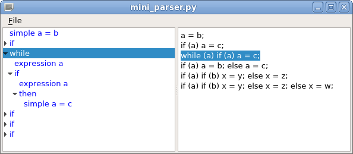

# An Example of a Syntactic Analyzer

An example of a hand-written syntactic analyzer that recognizes simple
statements.
At the place of expressions it allows only identifiers.
The functions **openBranch**, **closeBranch** and **put** display the
results in a tree.
The function **setLine** stores into the tree the number of the source
text line being processed. (Clicking in the tree highlights the source
line.)
We use the [lexical analyzer](lexer.md) described earlier.



https://gitlab.fjfi.cvut.cz/culikzde/simple-view/-/blob/main/tutorial/mini-parser/mini_parser.py#L205

```python
    def readIdent (self, lexer) :
        result = lexer.tokenText
        if not lexer.isIdentifier () :
           lexer.error ("Identifier expected")
        lexer.nextToken ()
        return result

    def parseExpr (self, lexer) :
        a = self.readIdent (lexer)
        self.put ("expression " + a )

    def parseSimpleStat (self, lexer) :
        a = self.readIdent (lexer)
        lexer.checkSeparator ('=')
        b = self.readIdent (lexer)
        lexer.checkSeparator (';')
        self.put ("simple " + a + " = " + b)

    def parseWhile (self, lexer) :
        self.openBranch ("while")
        self.setLine (lexer)
        lexer.checkKeyword ("while")
        lexer.checkSeparator ('(')
        self.parseExpr (lexer)
        lexer.checkSeparator (')')
        self.parseStat (lexer)
        self.closeBranch ()

    def parseIf (self, lexer) :
        self.openBranch ("if")
        self.setLine (lexer)
        lexer.checkKeyword ("if")
        lexer.checkSeparator ('(')
        self.parseExpr (lexer)
        lexer.checkSeparator (')')

        self.openBranch ("then")
        self.parseStat (lexer)
        self.closeBranch ()

        if lexer.isKeyword ("else") :
           lexer.nextToken () # preskoc else
           self.openBranch ("else")
           self.parseStat (lexer)
           self.closeBranch ()
        self.closeBranch ()

    def parseStat (self, lexer) :
        if lexer.isKeyword ("if") :
           self.parseIf (lexer)
        elif lexer.isKeyword ("while") :
           self.parseWhile (lexer)
        else :
           self.parseSimpleStat (lexer)


```

Literature: http://homepages.cwi.nl/~steven/pascal/book/2syntax.html
