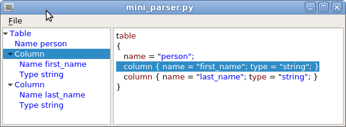

# An Example of a Parser for the Description of Database Tables

An example of a table description:

```
table
{
   name = "person";
   column { name = "first_name"; type = "string"; }
   column { name = "last_name"; type = "string"; }
}
```

Our parser will read the description of the table from the input.
It will display the obtained information in a tree:



http://gitlab.fjfi.cvut.cz/culikzde/simple-view/-/blob/master/tutorial/mini-parser/mini_parser.py#L264

The source text is shared with the previous example.

```python
    def parseValue (self, lexer) :
        lexer.nextToken () # skip name
        lexer.checkSeparator ('=')
        if lexer.token == lexer.string_literal :
           result = lexer.tokenText
           lexer.nextToken () # skip string
        else :
           lexer.error ("Value expected (as string)");

        # lexer.checkSeparator (';')

        # if lexer.isSeparator (';') :
        #    lexer.nextToken ()

        if not lexer.isSeparator ('}') :
           lexer.checkSeparator (';')

        return result

    def parseColumn (self, lexer) :
        self.openBranch ("Column")
        self.setLine (lexer)
        lexer.nextToken () # skip column
        lexer.checkSeparator ('{')
        while not lexer.isSeparator ('}') :
            if lexer.isKeyword ("name") :
               name = self.parseValue (lexer)
               self.put ("Name " + name)
            elif lexer.isKeyword ("type") :
               type = self.parseValue (lexer)
               self.put ("Type " + type)
            else :
               lexer.error ("Unknown column statement");
        lexer.checkSeparator ('}')
        self.closeBranch ()

    def parseTable (self, lexer) :
        self.openBranch ("Table")
        self.setLine (lexer)
        lexer.nextToken () # skip table
        lexer.checkSeparator ('{')
        while not lexer.isSeparator ('}') :
            if lexer.isKeyword ("name") :
               name = self.parseValue (lexer)
               self.put ("Name " + name)
            elif lexer.isKeyword ("column") :
               self.parseColumn (lexer)
            else :
               lexer.error ("Unknown table statement");

        lexer.checkSeparator ('}')
        self.closeBranch ()


```
