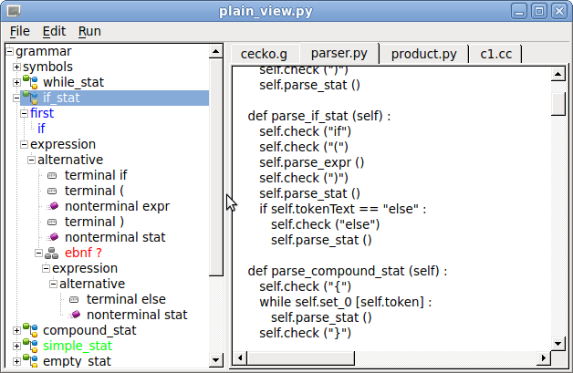

# A Syntactic Analyzer (Parser) Recognizing the Given Language

Programs for generating syntactic analyzers read a grammar description
from the input and produce the source text of a parser.

We begin with syntactic analyzers that only recognize the given
language.
That is, they decide whether the input source text satisfies the given
grammar.

Let us look at one grammar rule from the given grammar:

```
   if_stat  :  "if" "(" expr ")" stat ( "else" stat  )? ;
```

The generator creates the Parser class and, inside it, for the mentioned
rule the method **parse_if_stat**:

```python
from lexer import Lexer

class Parser (Lexer) :

   def parse_if_stat (self) :
      self.check ("if")
      self.check ("(")
      self.parse_expr ()
      self.check (")")
      self.parse_stat ()
      if self.tokenText == "else" :
         self.check ("else")
         self.parse_stat ()
```

The method checks the presence of the terminals.
For the nonterminals it calls the corresponding methods.
The decision of which alternative to continue with is governed by the
sets of symbols with which the individual alternatives begin.

Or a generated parser in the C++ language:

```cpp
void CmmParser::parse_if_stat ()
{
   match (KEYWORD_if);
   match (LPAREN);
   parse_expr ();
   match (RPAREN);
   parse_stat ();
   if (isSymbol (KEYWORD_else))
   {
      nextSymbol ();
      parse_stat ();
   }
}
```

# The Program Generating the Syntactic Analyzer

The program *written in Python* generating a syntactic analyzer *also
written in Python*.

http://gitlab.fjfi.cvut.cz/culikzde/simple-view/-/blob/master/tutorial/plain-grammar/plain_toparser.py

( This chapter uses the variant with the constant generate_tree = False )

## The Input Will Be Our Usual Small Grammar

```
while_stat :  "while" "(" expr ")" stat   ;
if_stat    :  "if" "(" expr ")" stat ( "else" stat  )?   ;
compound_stat : "{" ( stat )* "}" ;
simple_stat :  expr ";" ;
empty_stat :  ";" ;

stat : while_stat | if_stat | compound_stat | simple_stat | empty_stat ;

simple_expr : identifier | number  | "(" expr ")" ;
mult_expr :  simple_expr ( ("*"|"/") simple_expr )* ;
add_expr :  mult_expr ( ("+"|"-") mult_expr )* ;

expr : add_expr ( "=" expr )? ;
program : stat;
```

## The Generated Syntactic Analyzer Includes Lexical Analysis

The created Parser class is derived from the lexical analyzer.
[the already described minimal lexical analyzer](lexer.md)
Complete source text
http://gitlab.fjfi.cvut.cz/culikzde/simple-view/-/blob/master/tutorial/plain-grammar/plain_lexer.py

```python
from plain_lexer import Lexer

class Parser (Lexer) :
```

In the constructor the terminal symbols are numbered.

- *"Multiterminals"* already have their numbers from the Lexer and here
  they appear only as comments
- Keywords get their constants (**keyword_else**)
- Separators are denoted just by numbers
- For some symbol sets constants are declared (for example **set_0**)

```python
   def __init__ (self) :
      super (Parser, self).__init__ ()

      # eos = 0
      # identifier = 1
      # number = 2
      # real_number = 3
      # character_literal = 4
      # string_literal = 5
      # separator = 6
      # end_of_line = 7
      self.keyword_else = 8
      self.keyword_if = 9
      self.keyword_while = 10
      # ( 11
      # ) 12
      # * 13
      # + 14
      # , 15
      # - 16
      # / 17
      # ; 18
      # { 19
      # } 20

      self.set_0 = self.alloc ([self.identifier, self.number, self.keyword_if, self.keyword_while, 11, 18, 19])
      # identifier  number  if  while  (  ;  {
```

The virtual function **lookupKeyword**, called by the lexer after
reading an identifier,
converts some identifiers into keywords:

```python
   def lookupKeyword (self) :
      s = self.tokenText
      n = len (s)
      if n == 2 :
         if s[0:2] == "if" :
            self.token = self.keyword_if
      elif n == 4 :
         if s[0:4] == "else" :
            self.token = self.keyword_else
      elif n == 5 :
         if s[0:5] == "while" :
            self.token = self.keyword_while
```

The function **processSeparator** recognizes the separators:

```python
   def processSeparator (self) :
      if self.tokenText == '(' :
         self.token = 11
      if self.tokenText == ')' :
         self.token = 12
      if self.tokenText == '*' :
         self.token = 13
      if self.tokenText == '+' :
         self.token = 14
      if self.tokenText == ',' :
         self.token = 15
      if self.tokenText == '-' :
         self.token = 16
      if self.tokenText == '/' :
         self.token = 17
      if self.tokenText == ';' :
         self.token = 18
      if self.tokenText == '{' :
         self.token = 19
      if self.tokenText == '}' :
         self.token = 20
      if self.token == self.separator :
         self.error ("Unknown separator")
```

The helper function **tokenToString** is useful when displaying errors:

```python
   def tokenToString (self, value) :
      if value == 0: return "<end of source text>"
      if value == 1: return "<identifier>"
      if value == 2: return "<number>"
      # ...
      if value == 9: return "if"
      if value == 10: return "while"
      if value == 11: return "("
      if value == 12: return ")"
      # ...
```

The function **storeLocation** stores the line number of the source
text, used for example by navigation trees:

```python
   def storeLocation (self, item) :
      item.src_line = self.tokenLineNum
      item.src_column = self.tokenColNum
      item.src_pos = self.tokenByteOfs
      item.src_end = self.charByteOfs
```

## The Generated Syntactic Analyzer

Let us see how the [symbol sets](gram_symbols.md) from the previous
chapter are used when selecting an alternative:

```python
   def parse_add_expr (self) :
      self.parse_mult_expr ()
      while self.tokenText == "+" or self.tokenText == "-" :
         if self.tokenText == "+" :
            self.check ("+")
         elif self.tokenText == "-" :
            self.check ("-")
         else :
            self.error ("Unexpected token")
         self.parse_mult_expr ()
```

If for some alternative the set has two or three elements, we generate a
condition using several **or**s:

```python
   def parse_stat (self) :
      if self.tokenText == "while" :
         self.parse_while_stat ()
      elif self.tokenText == "if" :
         self.parse_if_stat ()
      elif self.tokenText == "{" :
         self.parse_compound_stat ()
      elif self.token == identifier or self.token == number or self.tokenText == "(" :
         self.parse_simple_stat ()
      elif self.tokenText == ";" :
         self.parse_empty_stat ()
      else :
         self.error ("Unexpected token")
```

In the case of a larger set, we generate a constant (the array
**set_0**) and use it for testing.
( The function register_collection in
http://gitlab.fjfi.cvut.cz/culikzde/simple-view/-/blob/master/tutorial/plain-grammar/plain_toparser.py#L177 )

```python
   def parse_compound_stat (self) :
      self.check ("{")
      while self.set_0 [self.token] :
         self.parse_stat ()
      self.check ("}")
```

Here are the methods recognizing the remaining rules:

```python
class Parser (Lexer) :

   def parse_while_stat (self) :
      self.check ("while")
      self.check ("(")
      self.parse_expr ()
      self.check (")")
      self.parse_stat ()

   def parse_if_stat (self) :
      self.check ("if")
      self.check ("(")
      self.parse_expr ()
      self.check (")")
      self.parse_stat ()
      if self.tokenText == "else" :
         self.check ("else")
         self.parse_stat ()

   def parse_simple_stat (self) :
      self.parse_expr ()
      self.check (";")

   def parse_empty_stat (self) :
      self.check (";")

   def parse_simple_expr (self) :
      if self.token == identifier :
         self.readIdentifier ()
      elif self.token == number :
         self.readNumber ()
      elif self.tokenText == "(" :
         self.check ("(")
         self.parse_expr ()
         self.check (")")
      else :
         self.error ("Unexpected token")

   def parse_mult_expr (self) :
      self.parse_simple_expr ()
      while self.tokenText == "*" or self.tokenText == "/" :
         if self.tokenText == "*" :
            self.check ("*")
         elif self.tokenText == "/" :
            self.check ("/")
         else :
            self.error ("Unexpected token")
         self.parse_simple_expr ()

   def parse_expr (self) :
      self.parse_add_expr ()
      if self.tokenText == "=" :
         self.check ("=")
         self.parse_expr ()

   def parse_program (self) :
      self.parse_stat ()
```

## The Interactive Program plain_view.py Generating Syntactic Analyzers

https://gitlab.fjfi.cvut.cz/culikzde/simple-view/-/blob/master/tutorial/plain-grammar/plain_view.py



The function that takes the text of the given grammar from the first
tab,
stores the grammar into a tree (**parseRules**),
computes the sets of starting symbols (**initSymbols**),
and generates the parser (**parserFromGrammar**):

```python
    def createParser (self) :
        # self.tree.clear ()
        edit = self.getEditor ()
        if edit != None :
           source = edit.toPlainText ()

           grammar = Grammar ()
           grammar.openString (source)

           grammar.parseRules ()
           initSymbols (grammar)

           self.parserFileName = self.outputFileName ("parser.py")
           self.productFileName = self.outputFileName ("product.py")

           to_parser = ToParser ()
           to_parser.open (self.parserFileName)
           to_parser.parserFromGrammar (grammar)
           to_parser.close ()
           self.readFile (None, self.parserFileName)

           to_product = ToProduct ()
           to_product.open (self.productFileName)
           to_product.productFromGrammar (grammar)
           to_product.close ()
           self.readFile (None, self.productFileName)

           self.grammarTree (grammar, edit)
```

## Generating the Syntactic Analyzer Yourself

http://gitlab.fjfi.cvut.cz/culikzde/simple-view/-/blob/master/tutorial/plain-grammar/plain_toparser.py

Similarly to when we determined the sets of starting symbols, we walk
through the whole grammar stored in tree form.

For all the rules we generate a **parse_...** method:

```python
   def parserFromRules (self, grammar) :
       for rule in grammar.rules :
           self.parserFromRule (grammar, rule)

   def parserFromRule (self, grammar, rule) :
       grammar.updatePosition (rule)

       self.putLn ("def parse_" + rule.name + " (self) :")
       self.incIndent ()

       self.parserFromExpression (grammar, rule, rule.expr)

       self.decIndent ()
       self.putEol ()
```

For the individual alternatives we write **if** statements:

```python
   def parserFromExpression (self, grammar, rule, expr) :
       cnt = len (expr.alternatives)
       inx = 0
       start = True
       for alt in expr.alternatives :
           if cnt > 1 :
              cond = self.conditionFromAlternative (grammar, alt)
              if start :
                 self.put ("if")
              else :
                 self.put ("elif")
              start = False
              self.putLn (" " + cond + " :")
              self.incIndent ()
           self.parserFromAlternative (grammar, rule, alt)
           if cnt > 1 :
              self.decIndent ()
           inx = inx + 1
       if cnt > 1 :
          self.putLn ("else :")
          self.incIndent ()
          self.putLn ("self.error (" +  '"' + "Unexpected token" + '"' + ")")
          self.decIndent ()
```

We process the individual items forming an alternative one by one:

```python
   def parserFromAlternative (self, grammar, rule, alt) :
       for item in alt.items :
           if isinstance (item, Terminal) :
              self.parserFromTerminal (grammar, rule, item)
           elif isinstance (item, Nonterminal) :
              self.parserFromNonterminal (grammar, rule, item)
           elif isinstance (item, Ebnf) :
              self.parserFromEbnf (grammar, rule, item)
           else :
              grammar.error ("Unknown alternative item: " + item.__class__.__name__)
```

For an expression in parentheses we generate **if** or **while**:

```python
   def parserFromEbnf (self, grammar, rule, ebnf) :
       if ebnf.mark == '?' :
          self.put ("if ")
       elif ebnf.mark == '*' :
          self.put ("while ")
       elif ebnf.mark == '+' :
          self.put ("while ")

       if ebnf.mark != "" :
          cond = self.conditionFromExpression (grammar, ebnf.expr)
          self.put (cond)
          self.putLn (" :")
          self.incIndent ()

       self.parserFromExpression (grammar, rule, ebnf.expr)

       if ebnf.mark != "" :
          self.decIndent ()
```

For nonterminals we call the corresponding parse_... method:

```python
   def parserFromNonterminal (self, grammar, rule, item) :
       self.putLn ("self.parse_" + item.rule_name + " ()")
```

For ordinary terminals we check the presence of the text on the input
(and the **check** function advances the input to the next lexical
symbol).

In the case of *"multiterminals"* (identifiers, integers and real
numbers, strings in single and double quotes)
we call **readIdentifier**, **readNumber**, ... from the lexer:
http://gitlab.fjfi.cvut.cz/culikzde/simple-view/-/blob/master/tutorial/plain-grammar/plain_lexer.py

```python
   def parserFromTerminal (self, grammar, rule, item) :
       symbol = item.symbol_ref
       if symbol.multiterminal :

          func = symbol.ident
          if func.endswith ("_number") :
             func = func [ : -7 ]
          if func.endswith ("_literal") :
             func = func [ : -8 ]
          func = "read" + func.capitalize()

          self.putLn ("self." + func + " ()")
       else :
          if symbol.text != "":
             self.putLn ("self.check (" + '"' + symbol.text + '"' + ")")
```

## Decision Conditions for the Individual Alternatives

The **condition** function is to create/write a condition for the given
set of starting symbols **collection**.

Depending on the number of elements of the set, it writes one
comparison, several **or**s,
or it declares a new constant (if it has not been declared yet):

```python
   def condition (self, grammar, collection) :
       cnt = 0
       for inx in range (len (collection)) :
           if collection [inx] :
              cnt = cnt + 1

       if cnt == 0 :
          # grammar.error ("Empty set")
          # return "nothing"
          code = "True" # !?
       elif cnt <= 3 :
          code = ""
          start = True
          for inx in range (len (collection)) :
              if collection [inx] :
                 if not start :
                    code = code + " or "
                 start = False
                 symbol = grammar.symbols[inx]
                 if symbol.text != "" :
                    code = code + "self.tokenText == " + '"' + symbol.text + '"'
                 else :
                    code = code + "self.token == " + symbol.ident
       else :
          num = self.registerCollection (grammar, collection)
          code = "self.set_" + str (num) + " [self.token]";

       return code
```

```python
   def conditionFromAlternative (self, grammar, alt) :
       code = self.condition (grammar, alt.first)
       return code
```

```python
   def conditionFromExpression (self, grammar, expr) :
       code = ""
       for alt in expr.alternatives :
           if code != "" :
              code = code + " or "
           code = code + self.conditionFromAlternative (grammar, alt)
       return code
```
