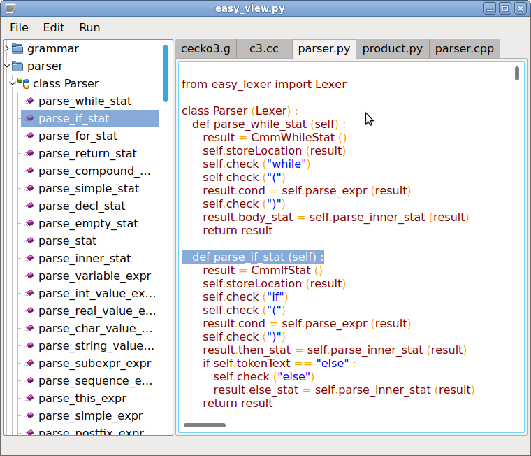
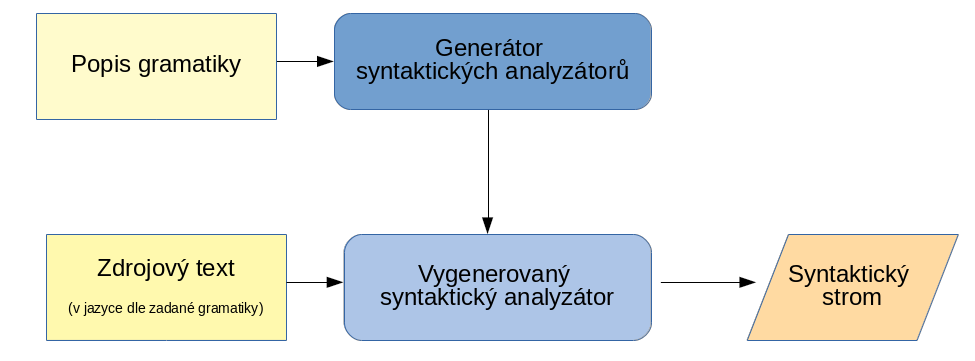

# A Syntactic Analyzer Creating a Syntactic Tree

## The Input Grammar with Attributes

We extend the input grammar with attributes describing the storing of
information into the syntactic tree.

Before the name of a nonterminal, the name of a variable may be given,
into which the corresponding syntactic subtree will be stored:

```
      else_code : stat
```

After the rule name, there may be the identifier of a class for storing
the data from one node of the syntactic tree.
After the class identifier, there may be the identifier of the parent
class from which the first class is derived:

```
      if_stat < CmmIfStat: CmmStat >  : ... ;
```

For example, the rule for the **if** statement:

```
if_stat < CmmIfStat: CmmStat >  :
   "if"
   "(" cond:expr ")"
   then_code:stat
   (
      <new_line>
      "else"
      else_code:stat
   )? ;
```

From the rule description the generator writes the declaration of a
class for storing the tree node corresponding to the rule *if_stat*.
Assume that the rules *expr* and *stat* have *CmmExpr* and *CmmStat* as
their types; then if we generate the analyzer in the C++ language, the
following declaration is created:

```cpp
class CmmIfStat : public CmmStat
{
   public:
      CmmExpr *  cond;
      CmmStat *  then_stat;
      CmmStat *  else_stat;
};
```

or, if we generate an analyzer written in Python:

```python
class CmmIfStat (CmmStat) :
   def __init__ (self) :
      super (CmmIfStat, self).__init__ ()
      self.cond = None
      self.then_code = None
      self.else_code = None
```

The program for reading a grammar with extending attributes:
[easy_grammar.py](http://gitlab.fjfi.cvut.cz/culikzde/simple-view/-/blob/master/tutorial/easy-grammar/easy_grammar.py)

## The Generated Analyzer

The analyzer recognizes whether the source text on the input satisfies
the given grammar,
and at the same time it creates the syntactic tree from the mentioned
classes.

According to the given grammar, the generator writes the class
*Parser* implementing the syntactic analyzer.
For the individual rules the generator writes methods in this class:

```python
class Parser (Lexer) :
   def parse_if_stat (self) :
      result = CmmIfStat ()
      self.storeLocation (result)
      self.check ("if")
      self.check ("(")
      result.cond = self.parse_expr ()
      self.check (")")
      result.then_code = self.parse_stat ()
      if self.tokenText == "else" :
         self.check ("else")
         result.else_code = self.parse_stat ()
      return result
```

The method **parse_if_stat** creates a new instance of the **CmmIfStat**
class, which will also be the result of this method.
Into the created instance we store the information about the line number
in the source file,
*which we use for example when clicking in the graphical representation
of the syntactic tree — the corresponding source line can be
highlighted.*

Then it checks whether the terminal symbols **if** and **(** are present
on the input.

To process the expression it calls the method **parse_expr** and stores
the reference to the subtree describing the expression into the item
**cond** of the created instance.

It checks **)** and the method **parse_stat** stores the reference to
the *"then"* statement into the item **then_code**.

Based on the [sets of lexical symbols](gram_symbols.md) with which the
individual rules begin,
the generator decides that it must test whether the terminal symbol
**else** follows.

The function **check ("else")** just skips the else symbol, which we
know will be there.

**parse_stat** stores the *"else"* statement into the item
**else_code**.

If the terminal **else** is not present, the item **else_code** remains
set to the value **None**,
which was placed there by the constructor of the class **CmmIfStat**.

The program generating the syntactic analyzer:
[easy_toparser.py](http://gitlab.fjfi.cvut.cz/culikzde/simple-view/-/blob/master/tutorial/easy-grammar/easy_toparser.py)

## The Generated Analyzer in the C++ Language

Optionally, the generator of a syntactic analyzer in the C++ language:
[easy_cparser.py](http://gitlab.fjfi.cvut.cz/culikzde/simple-view/-/blob/master/tutorial/easy-grammar/easy_cparser.py)

```cpp
CmmIfStat * CmmParser::if_stat ()
{
   CmmIfStat * result = new CmmIfStat;

   match (KEYWORD_if);
   match (LPAREN);
   result->cond = expr ();
   match (RPAREN);

   result->then_stat = stat ();
   if (isSymbol (KEYWORD_else))
   {
      match (KEYWORD_else);
      result->else_stat = stat ();
   }

   return result;
}
```

## Generating Syntactic Analyzers

A simple graphical interface for generating syntactic analyzers:
[easy_view.py](http://gitlab.fjfi.cvut.cz/culikzde/simple-view/-/blob/master/tutorial/easy-grammar/easy_view.py)




